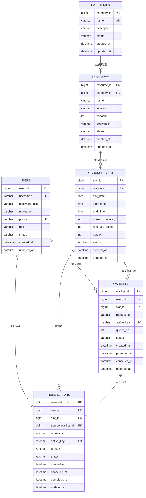

# ResourceFlow 研修室预约系统数据库 ER 图

## 一、业务场景

系统面向研修室预约场景：用户可以查看研修室分类、研修室信息和指定日期的可预约时段；预约满后可以加入候补队列；已有预约取消后，系统按照候补顺序自动递补。管理员负责维护研修室及分类，并查看预约和候补情况。

## 二、ER 图

实体名称使用英文表名，属性说明和业务含义使用中文，便于数据库落地和代码映射。



## 三、实体及属性说明

### 1. 用户表 `users`

记录研修室预约系统的普通用户和管理员账号。

| 属性 | 类型 | 约束 | 说明 |
|---|---|---|---|
| `user_id` | bigint | 主键 | 用户 ID |
| `username` | varchar | 非空、唯一 | 登录用户名 |
| `password_hash` | varchar | 非空 | 加密后的密码，不能保存明文密码 |
| `nickname` | varchar | 非空 | 用户显示名称 |
| `phone` | varchar | 唯一，可为空 | 手机号，可用于账号识别或通知 |
| `role` | varchar | 非空 | `USER` 普通用户、`ADMIN` 管理员 |
| `status` | varchar | 非空 | `ENABLED` 正常、`DISABLED` 停用 |
| `created_at` | datetime | 非空 | 注册时间 |
| `updated_at` | datetime | 非空 | 最后更新时间 |

设计说明：登录成功后只向客户端返回 JWT，不返回 `password_hash`。管理员权限由 `role` 控制，账号停用后不能继续登录或创建预约。

### 2. 研修室分类表 `categories`

用于区分不同类型的研修室，例如“小型研修室”“多媒体研修室”“大型研修室”。

| 属性 | 类型 | 约束 | 说明 |
|---|---|---|---|
| `category_id` | bigint | 主键 | 分类 ID |
| `name` | varchar | 非空、唯一 | 分类名称 |
| `description` | varchar | 可为空 | 分类说明 |
| `status` | varchar | 非空 | `ENABLED` 启用、`DISABLED` 停用 |
| `created_at` | datetime | 非空 | 创建时间 |
| `updated_at` | datetime | 非空 | 最后更新时间 |

设计说明：分类停用后不允许新建或展示该分类下的可用研修室，但历史预约记录保留。

### 3. 研修室表 `resource`

记录可以被预约的具体研修室，例如“1 楼 A101 研修室”。

| 属性 | 类型 | 约束 | 说明 |
|---|---|---|---|
| `resource_id` | bigint | 主键 | 研修室 ID |
| `category_id` | bigint | 外键、非空 | 所属分类，关联 `categories.category_id` |
| `name` | varchar | 非空 | 研修室名称，例如 `A101 研修室` |
| `location` | varchar | 非空 | 位置，例如 `1 楼 A101` |
| `capacity` | int | 非空、正数 | 研修室物理容纳人数，例如 12 人 |
| `description` | varchar | 可为空 | 设备和使用说明，例如是否配备投影仪 |
| `status` | varchar | 非空 | `ENABLED` 可预约、`DISABLED` 停用 |
| `created_at` | datetime | 非空 | 创建时间 |
| `updated_at` | datetime | 非空 | 最后更新时间 |

设计说明：`capacity` 表示研修室最多容纳多少人，不等于预约名额。一个研修室通常在一个时间段只允许一笔预约，因此该时间段的预约名额由 `resource_slots.booking_capacity` 单独控制。建议使用 `(name, location)` 唯一索引，避免重复创建同一研修室。

### 4. 研修室时间段表 `resource_slots`

记录某个研修室在某个日期的具体可预约时间段，例如“2026-10-08 09:00 至 10:00”。它是系统控制预约库存和防超卖的核心表。

| 属性 | 类型 | 约束 | 说明 |
|---|---|---|---|
| `slot_id` | bigint | 主键 | 时间段 ID |
| `resource_id` | bigint | 外键、非空 | 研修室 ID，关联 `resources.resource_id` |
| `slot_date` | date | 非空 | 预约日期 |
| `start_time` | time | 非空 | 开始时间 |
| `end_time` | time | 非空 | 结束时间，必须晚于开始时间 |
| `booking_capacity` | int | 非空、正数 | 该时间段允许的预约数量，单预约研修室通常为 1 |
| `reserved_count` | int | 非空、默认 0 | 当前已确认预约数量 |
| `version` | int | 非空、默认 0 | 乐观锁版本号 |
| `status` | varchar | 非空 | `AVAILABLE` 可预约、`FULL` 已满、`DISABLED` 不可用、`EXPIRED` 已过期 |
| `created_at` | datetime | 非空 | 创建时间 |
| `updated_at` | datetime | 非空 | 最后更新时间 |

设计说明：`resource_id + slot_date + start_time + end_time` 建立唯一索引，确保同一研修室同一天不会生成重复时间段。`booking_capacity` 是预约库存，`reserved_count` 是已使用库存，两者分开可以支持普通研修室单名额预约，也可以支持一个时段允许多人预约的场景。

### 5. 预约表 `reservations`

记录用户对研修室时间段的预约，包括正常预约、取消预约和自动递补产生的预约。

| 属性 | 类型 | 约束 | 说明 |
|---|---|---|---|
| `reservation_id` | bigint | 主键 | 预约 ID |
| `user_id` | bigint | 外键、非空 | 预约用户，关联 `users.user_id` |
| `slot_id` | bigint | 外键、非空 | 预约时间段，关联 `resource_slots.slot_id` |
| `source_waitlist_id` | bigint | 外键，可为空 | 递补来源候补记录；主动预约时为空 |
| `request_id` | varchar | 非空 | 客户端幂等请求号 |
| `active_key` | varchar | 可为空、唯一 | 活跃预约唯一键，例如 `user_id:slot_id`；取消后置空 |
| `remark` | varchar | 可为空 | 预约备注，例如“项目讨论” |
| `status` | varchar | 非空 | `CONFIRMED` 已确认、`CANCELLED` 已取消、`COMPLETED` 已完成 |
| `created_at` | datetime | 非空 | 创建时间 |
| `cancelled_at` | datetime | 可为空 | 取消时间 |
| `completed_at` | datetime | 可为空 | 完成时间 |
| `updated_at` | datetime | 非空 | 最后更新时间 |

设计说明：预约表只保存 `slot_id`，日期、开始时间、结束时间和研修室信息通过关联 `resource_slots`、`resource` 查询，避免冗余字段不一致。`source_waitlist_id` 用于追踪“哪个候补用户被递补成了这笔预约”。

### 6. 候补队列表 `waitlists`

记录研修室时间段已满时，用户按照先来先服务原则加入的候补队列。

| 属性 | 类型 | 约束 | 说明 |
|---|---|---|---|
| `waitlist_id` | bigint | 主键 | 候补记录 ID |
| `user_id` | bigint | 外键、非空 | 候补用户，关联 `users.user_id` |
| `slot_id` | bigint | 外键、非空 | 候补时间段，关联 `resource_slots.slot_id` |
| `request_id` | varchar | 非空 | 客户端幂等请求号 |
| `active_key` | varchar | 可为空、唯一 | 活跃候补唯一键，例如 `user_id:slot_id`；递补或取消后置空 |
| `queue_no` | int | 非空 | 该时间段内的候补序号，从 1 开始 |
| `status` | varchar | 非空 | `WAITING` 排队中、`PROMOTED` 已递补、`CANCELLED` 已取消、`EXPIRED` 已失效 |
| `created_at` | datetime | 非空 | 加入候补时间 |
| `promoted_at` | datetime | 可为空 | 自动递补时间 |
| `cancelled_at` | datetime | 可为空 | 取消候补时间 |
| `updated_at` | datetime | 非空 | 最后更新时间 |

设计说明：按照 `slot_id + queue_no` 唯一约束维护一个时间段内的候补顺序。递补时查询 `status = 'WAITING'` 的最小 `queue_no`，将该记录更新为 `PROMOTED`，并在 `reservations` 中创建一笔预约。

## 四、实体关系说明

| 关系 | 基数 | 说明 |
|---|---|---|
| 分类 - 研修室 | 1:N | 一个分类下可以有多个研修室，一个研修室属于一个分类 |
| 研修室 - 时间段 | 1:N | 一个研修室可以按日期生成多个预约时间段 |
| 用户 - 预约 | 1:N | 一个用户可以有多条预约记录，一条预约只属于一个用户 |
| 时间段 - 预约 | 1:N | 一个时间段允许多个预约，具体上限由 `booking_capacity` 控制；单研修室通常为 1 |
| 用户 - 候补 | 1:N | 一个用户可以加入多个时间段的候补队列 |
| 时间段 - 候补 | 1:N | 一个时间段可以有多个候补用户 |
| 候补 - 递补预约 | 0..1:0..1 | 候补成功后最多生成一笔预约，通过 `source_waitlist_id` 关联 |

## 五、关键约束和索引设计

### 1. 唯一约束

```text
users:
  uk_users_username (username)
  uk_users_phone (phone)

categories:
  uk_categories_name (name)

resources:
  uk_resource_name_location (name, location)

resource_slots:
  uk_slot_resource_date_time (resource_id, slot_date, start_time, end_time)

reservations:
  uk_reservation_request (user_id, request_id)
  uk_reservation_active_key (active_key)

waitlists:
  uk_waitlist_request (user_id, request_id)
  uk_waitlist_active_key (active_key)
  uk_waitlist_queue (slot_id, queue_no)
```

`request_id` 用于接口幂等：客户端因网络超时重复提交时，服务端根据 `(user_id, request_id)` 找到原请求结果，不创建第二笔预约或候补记录。

`active_key` 只在记录处于有效状态时保存。预约取消后将其置为 `NULL`，这样既能保留历史记录，又能允许用户之后重新预约同一时间段。MySQL 的唯一索引允许多个 `NULL` 值，适合此设计。

### 2. 查询索引

```text
resources:
  idx_resources_category_status (category_id, status)

resource_slots:
  idx_slots_resource_date_status (resource_id, slot_date, status)

reservations:
  idx_reservations_user_status (user_id, status, created_at)
  idx_reservations_slot_status (slot_id, status)

waitlists:
  idx_waitlists_slot_status_queue (slot_id, status, queue_no, created_at)
```

这些索引分别支持资源列表、指定研修室日期可预约时段、我的预约、管理员预约查询，以及候补 FIFO 查询。

## 六、并发冲突和防超卖设计

数据库必须作为最终一致性边界，即使系统同时使用 Redis Lua 或分布式锁，也不能只依赖缓存库存。

预约时对时间段执行带条件的原子扣减：

```sql
UPDATE resource_slots
SET reserved_count = reserved_count + 1,
    version = version + 1,
    status = CASE
        WHEN reserved_count + 1 >= booking_capacity THEN 'FULL'
        ELSE 'AVAILABLE'
    END,
    updated_at = CURRENT_TIMESTAMP(3)
WHERE slot_id = ?
  AND status IN ('AVAILABLE', 'FULL')
  AND reserved_count < booking_capacity;
```

只有影响行数为 1 时，才允许继续插入预约记录。影响行数为 0 表示名额已经被其他并发请求抢完，应返回“研修室时间段已满”，而不是继续插入预约。

预约写入建议放在同一个数据库事务中：

1. 校验用户、研修室和时间段状态。
2. 原子增加 `resource_slots.reserved_count`。
3. 写入 `reservations`，依靠唯一索引处理重复请求和重复活跃预约。
4. 提交事务；任一步骤失败则回滚库存扣减。

## 七、取消和自动递补设计

取消预约时建议使用同一个事务：

1. 将预约状态更新为 `CANCELLED`，写入 `cancelled_at`，并将 `active_key` 置为 `NULL`。
2. 将对应时间段的 `reserved_count` 减 1；当库存重新可用时，将时间段状态恢复为 `AVAILABLE`。
3. 按 `queue_no`、`created_at` 查询第一条 `WAITING` 候补记录，并锁定该记录。
4. 将候补状态更新为 `PROMOTED`，写入 `promoted_at`，并清空候补 `active_key`。
5. 创建新的 `reservations` 记录，将 `source_waitlist_id` 设置为该候补记录 ID。
6. 递补成功后提交事务；如果事务失败，取消和递补一起回滚，避免出现库存与预约记录不一致。

如果系统采用异步递补，也必须使用“候补状态条件更新”保证幂等：只有 `status = 'WAITING'` 的记录才可以被更新为 `PROMOTED`，同一候补消息重复消费不会生成多笔预约。

## 八、删除和历史数据策略

所有业务表建议使用逻辑停用，不直接物理删除：

- 停用分类：更新 `categories.status = 'DISABLED'`。
- 停用研修室：更新 `resources.status = 'DISABLED'`。
- 停用时间段：更新 `resource_slots.status = 'DISABLED'`。
- 预约和候补历史保留，状态分别更新为 `CANCELLED` 或 `EXPIRED`。
- 外键删除策略建议使用 `RESTRICT`，防止删除研修室时破坏历史预约查询。

## 九、推荐状态值

| 对象 | 状态值 |
|---|---|
| 用户 | `ENABLED`、`DISABLED` |
| 分类 | `ENABLED`、`DISABLED` |
| 研修室 | `ENABLED`、`DISABLED` |
| 时间段 | `AVAILABLE`、`FULL`、`DISABLED`、`EXPIRED` |
| 预约 | `CONFIRMED`、`CANCELLED`、`COMPLETED` |
| 候补 | `WAITING`、`PROMOTED`、`CANCELLED`、`EXPIRED` |
